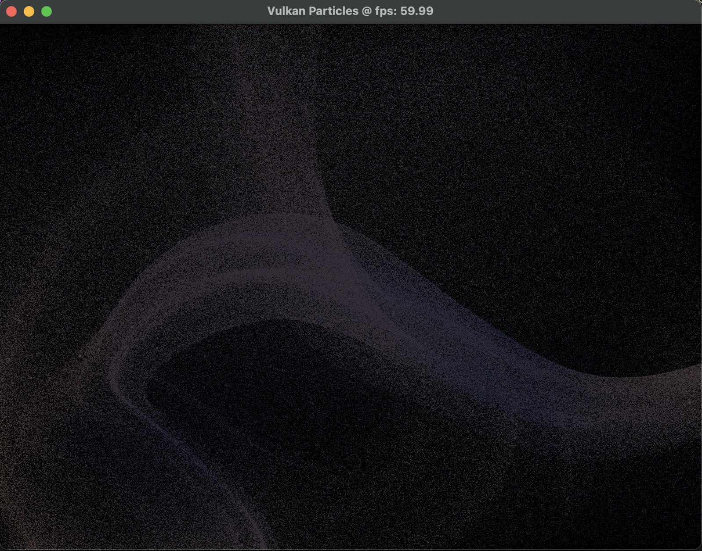

# vkParticles
A GPU-driven particle simulation using Vulkan compute shaders. Particle physics is updated entirely on the GPU, then rendered as point primitives.

## Features
- GPU particle simulation using compute shaders
- Vulkan-Hpp RAII
- Double-buffered shader storage buffers for particle state
- Timeline semaphores for compute and graphics synchronization
- Dynamic rendering (Vulkan 1.3+)
- Point-sprite rendering with velocity-based coloring
- Animated force fields and particle respawning
- Procedural particle initialization

Each particle stores its position and velocity. A compute shader updates particle velocities and positions, applying animated force fields and damping. Particles that move outside the simulation bounds are respawned at new positions.

The graphics pipeline renders the updated particle data as point primitives, with particle color influenced by velocity.
## License
This project is licensed under the BSD 3-Clause License. See the LICENSE file for details.